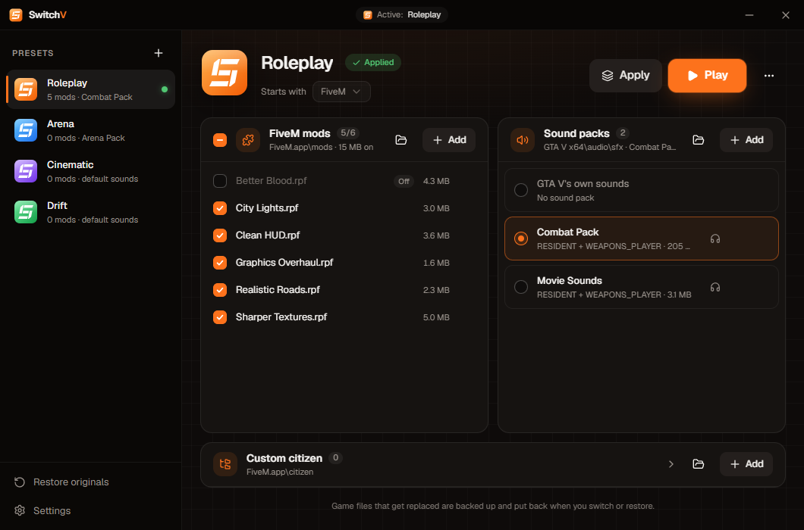
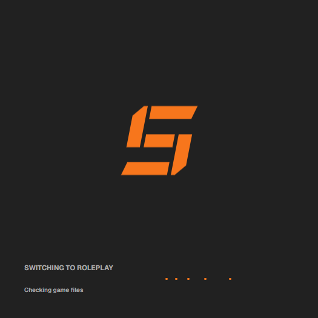
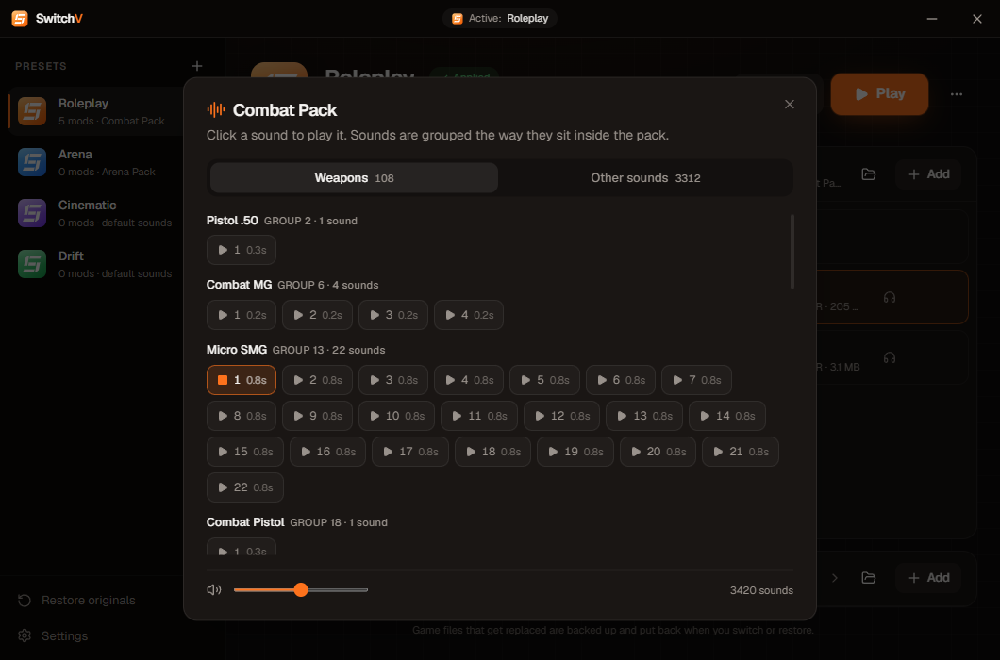

# SwitchV

**FiveM presets for Windows: your mods, sound packs and custom citizen files, switched in one click.** 
A *Roleplay* setup with all your mods, an *Arena* setup with just a sound pack. Pick one and play.

 

[Highlights](#-highlights) · [Getting started](#-getting-started) · [Sound preview](#-sound-preview) · [How switching works](#-how-switching-works) · [Your files are safe](#%EF%B8%8F-your-files-are-safe) · [FAQ](#-faq) · [Support](#-support-switchv)

---

## ✨ Highlights

|  |  |  |
|---|---|---|
| 🎛️ **Presets** One per way you play. Each has its own mods, sound pack and citizen files. | 🧩 **Mods on and off** Drop <code>.rpf</code> files or folders in, then tick the ones you want. | 🔊 **Sound packs** Keep as many as you like and pick one. Switching is instant. |
| 🎧 **Sound preview** Play the sounds inside a pack before you use it. | 🗂️ **Custom citizen** Custom citizen folders per preset, too. | 🚀 **Preset shortcuts** Desktop, Start menu or taskbar. One click switches and starts FiveM. |
| 🛡️ **Nothing gets lost** Your own mods and the game's files are set aside, never deleted. | 💾 **Light on disk space** On the same drive as FiveM, mods take no extra space. | 🔄 **Updates itself** New versions download quietly and install when you close it. |

---

## 🚀 Getting started

1. **[Download the installer](../../releases/latest)** (`SwitchV-x.y.z-setup.exe`) and run it. It installs for your Windows account only, so it doesn't need admin rights.
2. **Pick your FiveM.** SwitchV finds it by itself, including pure-mode shortcuts. Add each one you play with.
3. **Find GTA V.** It's detected automatically (Steam, Rockstar, Epic, or wherever FiveM points). If there's more than one copy, you choose.
4. **Choose where preset files are kept.** SwitchV suggests a folder on the same drive as FiveM, so your mods don't take extra space.
5. **Make a preset** and drop your files in:
   - **FiveM mods**: `.rpf` files (or folders of them). Each one can be turned on or off.
   - **Sound packs**: `RESIDENT.rpf` and `WEAPONS_PLAYER.rpf` together, or a folder that has both. Add several and pick one.
   - **Custom citizen**: your custom `citizen` folder.
6. **Press Play.** SwitchV puts the preset in place and starts the FiveM you chose.

Want it even quicker? Use a preset's **⋯** menu to add a shortcut to your desktop, Start menu or taskbar. The shortcut switches and starts FiveM without opening SwitchV, showing a loading screen styled like FiveM's own:

---

## 🎧 Sound preview

Not sure what a sound pack sounds like? Press the 🎧 button on any pack to play the sounds inside it, from the weapons to everything else in the pack. Weapons SwitchV can identify are named.

Previews work for packs saved the usual way (for example with OpenIV). GTA V's own sound files are encrypted, so they can't be previewed.

---

## 🔁 How switching works

When you apply a preset, SwitchV only moves files in the folders FiveM and GTA V already read:

| Folder | What SwitchV does |
|---|---|
| `FiveM.app\mods` | Puts the preset's turned-on mods there. Mods you put there yourself are moved aside while the preset is applied. |
| `GTA V\x64\audio\sfx` | Swaps `RESIDENT.rpf` and `WEAPONS_PLAYER.rpf` for the preset's sound pack. GTA V's originals go to `SwitchV-Backup` next to the game. |
| `FiveM.app\citizen` | Lays the preset's custom citizen files over FiveM's, keeping FiveM's originals to put back. |

Switching to another preset changes only what's different, so it's quick. SwitchV never changes files while FiveM or GTA V is running.

---

## 🛡️ Your files are safe

- **Nothing is deleted.** Your own mods and the game's original files are set aside, and SwitchV records exactly what it changed.
- **Restore originals** (bottom of the sidebar) puts everything back the way it was.
- **Uninstalling SwitchV puts everything back too**, before it removes itself.
- **Game updates win.** If a GTA V or FiveM update replaces a file while a preset is applied, SwitchV keeps the new file and never puts an old one back over it.
- **App updates don't touch your game or your presets**, and your preset shortcuts keep working.

---

## ❓ FAQ

<b>Windows says "Windows protected your PC" when I run the installer</b>

 
SwitchV is new and its installer isn't signed with a paid certificate yet, so SmartScreen doesn't recognize it. Click <b>More info</b>, then <b>Run anyway</b>.

<b>Why does SwitchV ask for admin access once?</b>

 
If GTA V is installed in a folder only administrators can change (like <code>Program Files</code>), SwitchV can't swap sound files there. It shows <b>Allow access</b>: Windows asks for admin once, and from then on your account can change those two folders. Nothing else on your PC changes.

<b>Does it work with pure mode?</b>

 
Yes. Add your pure-mode FiveM (or its shortcut) and pick it for a preset. Pure mode servers block client mods, so a preset for them usually has just a sound pack, or nothing.

<b>How much disk space does it use?</b>

 
Preset files live in the folder you chose (change it any time in <b>Settings → Storage</b>). When that folder is on the same drive as FiveM, mods are linked instead of copied, so they take no extra space. Sound packs and citizen files are copied, because game updates can rewrite them. <b>Settings → Storage</b> shows what's used and can clean up files no preset uses any more.

<b>Can I get in trouble on servers for using it?</b>

 
SwitchV doesn't touch the game while it runs. It only puts files in the folders FiveM and GTA V read, the same thing you'd do by hand. Each server decides which mods it allows, so follow the rules of the servers you play on.

<b>How do I uninstall it?</b>

 
Windows Settings → Apps → SwitchV → Uninstall. SwitchV first puts your original files back. Tick <i>Delete the application data</i> only if you also want your presets gone.

---

## 🔒 Privacy

No account, no ads, no tracking. The only thing SwitchV contacts is GitHub, to check for updates and show what's new.

## 💛 Support SwitchV

SwitchV is free. If it saves you time, you can support it here:

&nbsp;

---

Made by <a href="https://github.com/LAAGU">LAAGU</a>. SwitchV is not affiliated with Rockstar Games, Take-Two Interactive or Cfx.re.

